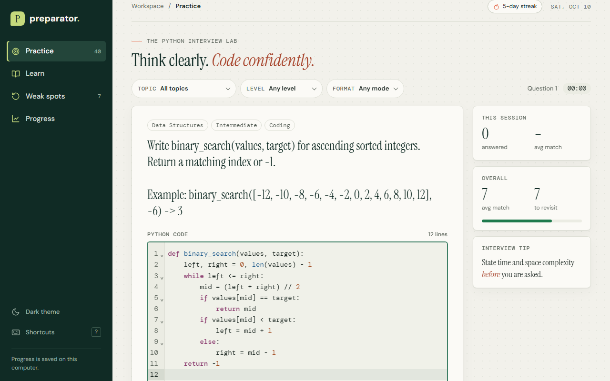
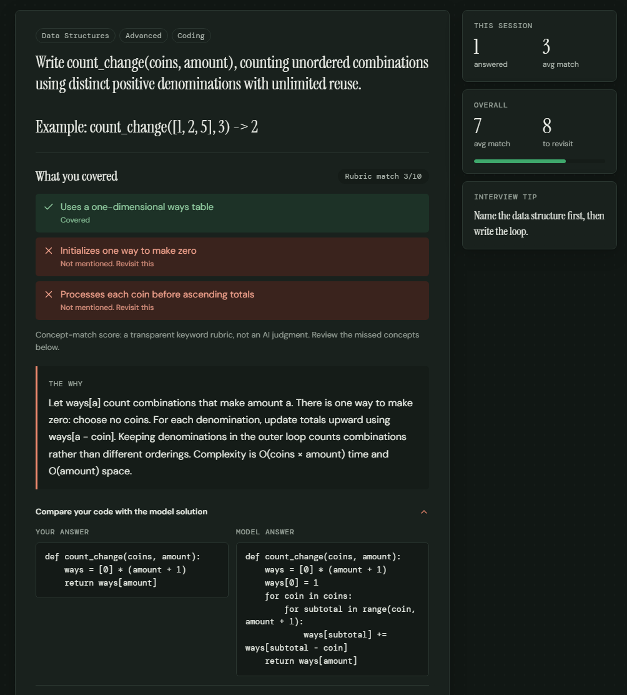
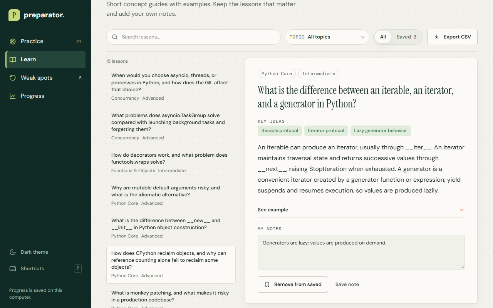
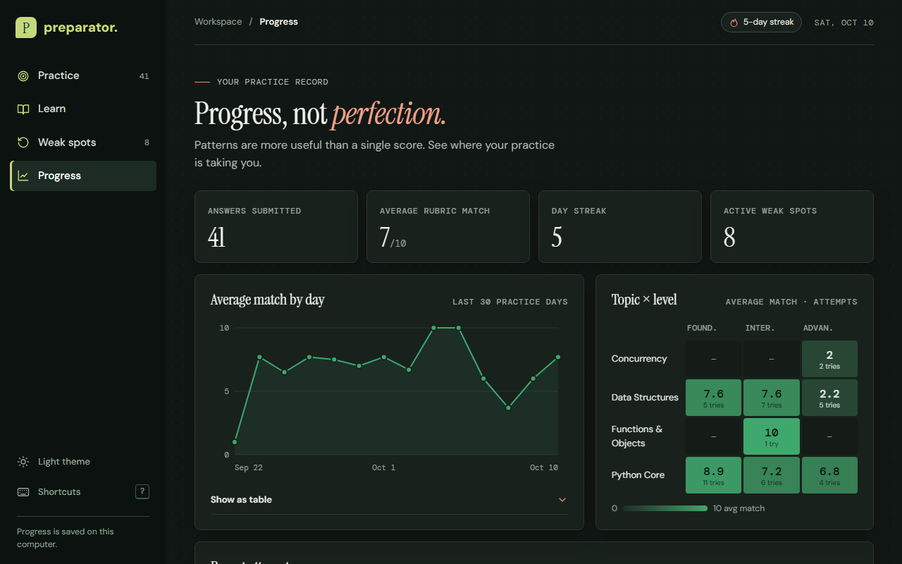
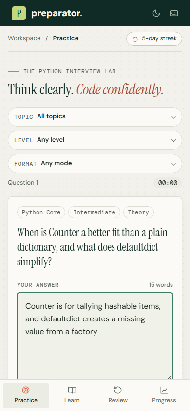
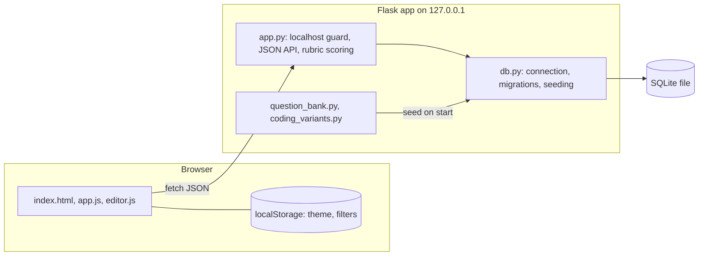
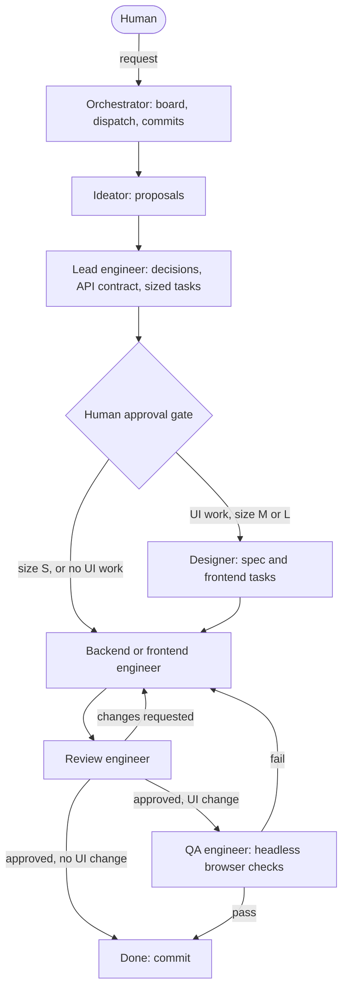

# Preparator

<!-- CI badge: replace REPO-NAME in both URLs below with the GitHub repository name after the first push. -->
[](https://github.com/shark12000/REPO-NAME/actions/workflows/ci.yml)

Preparator is a local web app for practicing Python interview questions. It is for developers preparing for Python interviews who want to answer one question at a time, get transparent feedback, and come back to what they missed. It runs on your own computer, with no account, and keeps your progress in a local SQLite file.

<table>
  <tr>
    <td></td>
    <td></td>
  </tr>
  <tr>
    <td></td>
    <td></td>
  </tr>
</table>
<p align="center"></p>

*Screenshots show demo data from a scratch database, not real practice history.*

## Features

- **Practice**: pick a topic, level and format (Theory or Coding), then answer one question at a time. The bank has the hand-written prompts plus 312 generated coding variants from 24 problem types, balanced across Foundations, Intermediate and Advanced.
- **Code editor**: coding questions open in a CodeMirror editor with Python highlighting, line numbers and auto-indent, and fall back to a plain text box if it cannot load. Submitted code is stored as text and never executed.
- **Transparent feedback**: a visible keyword rubric scores the answer out of 10 and lists each concept as "Covered" or "Not mentioned" (related terms earn half credit in the score), then shows the explanation and the model answer. Lines copied unchanged from the starter stub earn no credit. The rubric is a heuristic, not semantic or AI grading.
- **Weak spots**: missed questions, and any you save for review, go into a queue you can practice again.
- **Learn**: theory questions double as short lessons with personal notes. A lesson's explanation and example are sent to the browser only after you have answered that question once in Practice. **Export CSV** downloads your saved lessons and notes for import into Google Sheets (formula-like cells are neutralized), so the app never needs Google credentials.
- **Progress**: totals, a daily trend, a topic-by-level grid and your practice streak (days use your computer's time zone).
- **Interface**: light and dark themes, a phone layout, linkable views (`/#practice`, `/#learn`, `/#weaknesses`, `/#progress`) and keyboard shortcuts (`Ctrl+Enter` submit, `N` next, `S` save for review, `1`-`4` switch views, `?` list shortcuts).

**Privacy**: everything stays on your computer. The server listens on 127.0.0.1 only and makes no outbound calls; the page loads its web fonts from Google Fonts, and nothing else leaves the machine. Progress lives in `instance/preparator.sqlite3`; delete that file to reset.

## Tech stack

- Python 3.14, Flask 3, SQLite through the standard-library `sqlite3` module
- Vanilla JavaScript ES modules, plain CSS with design tokens, a vendored CodeMirror 6 bundle (no build step)
- `unittest`, ruff, and GitHub Actions CI on Linux and Windows; Playwright for headless browser checks during development

## Setup

You need Python 3.14 (and Node.js only if you want to run the JavaScript syntax checks).

Windows (PowerShell):

```powershell
git clone <repo-url> preparator; cd preparator
py -3.14 -m venv .venv
.venv\Scripts\python.exe -m pip install -r requirements.txt
.venv\Scripts\python.exe app.py
```

Linux and macOS:

```bash
git clone <repo-url> preparator && cd preparator
python3.14 -m venv .venv
.venv/bin/python -m pip install -r requirements.txt
.venv/bin/python app.py
```

Then open http://127.0.0.1:5000 and press **Start question**.

Optional environment variables: `PORT` (listen port, default 5000), `PREPARATOR_DATABASE` (path of the SQLite file), and `FLASK_DEBUG=1` (reloader and debugger; never use it when anyone else can reach the port).

## Tests and lint

`requirements-dev.txt` adds ruff and Playwright to the runtime pins. Point `PREPARATOR_DATABASE` at a scratch file so nothing touches your real progress.

Windows (PowerShell):

```powershell
.venv\Scripts\python.exe -m pip install -r requirements-dev.txt
$env:PREPARATOR_DATABASE = "$PWD\scratch.sqlite3"
.venv\Scripts\python.exe -m unittest discover -s tests
.venv\Scripts\python.exe -m ruff check app.py db.py question_bank.py coding_variants.py tests
.venv\Scripts\python.exe -m compileall -q app.py db.py question_bank.py coding_variants.py tests
node --check static/app.js; node --check static/editor.js
```

Linux and macOS:

```bash
.venv/bin/python -m pip install -r requirements-dev.txt
export PREPARATOR_DATABASE="$PWD/scratch.sqlite3"
.venv/bin/python -m unittest discover -s tests
.venv/bin/python -m ruff check app.py db.py question_bank.py coding_variants.py tests
.venv/bin/python -m compileall -q app.py db.py question_bank.py coding_variants.py tests
node --check static/app.js && node --check static/editor.js
```

CI runs the same checks on every push and pull request.

## Project structure

```
app.py                  Flask app: localhost guard, JSON API, rubric scoring, question selection
db.py                   SQLite connection, versioned migrations, seeding from the question bank
question_bank.py        hand-written questions, rubrics, explanations and solutions
coding_variants.py      312 generated coding prompts from 24 problem types
templates/index.html    the single-page shell
static/                 app.js (views, routing, API calls), editor.js, style.css, vendor/codemirror.js
tests/                  unittest suites, each test on its own temporary database
tools/qa/               headless-browser check helpers (Playwright)
tools/editor-bundle/    recipe for rebuilding static/vendor/codemirror.js
assets/screenshots/     the images in this README
ARCHITECTURE.md         design rules, boundaries and guardrails
CLAUDE.md, .claude/     the AI agent team setup (see below)
```

The CodeMirror bundle is prebuilt so the app needs no build step; see `tools/editor-bundle/README.md` to rebuild it.

## Architecture

One Flask process on 127.0.0.1 serves a single HTML page and a small JSON API; the browser switches views and calls that API; SQLite stores all progress. Question content lives in Python files and is copied into the database on start. `ARCHITECTURE.md` has the full rules.



## Built with a multi-agent AI team

Preparator was built by a team of Claude Code agents. Their instructions are in `CLAUDE.md` and `.claude/agents/`, and every agent may write only to its own files. The team's working record (task board, reviews, QA evidence, decision records) is kept in a private repository and is not part of this one.



Task sizes: S skips the designer and is reviewed with the same checklist on a smaller model; L adds a lead re-check against the architecture before implementation.

- **Orchestrator** (the main session): task board, dispatching, commits.
- **Ideator**: feature proposals.
- **Lead engineer**: architecture, decision records, API contract, sized tasks.
- **Designer**: UI specs and the frontend tasks for them.
- **Backend / frontend engineers**: Python and tests / templates, JavaScript and CSS.
- **Review engineer**: reviews every task, code or design.
- **QA engineer**: headless-browser checks on a scratch database, both themes, desktop and phone.

Lessons learned:

- Giving each agent its own files made parallel work safe: backend and frontend ran side by side once the API contract was written.
- Reviewing before QA, and running QA on the committed candidate, kept fix rounds small and diffable.
- Most extra rounds came from scope that changed after a task was written, so a scope change now goes back to the lead before work starts.
- Agents sometimes report more than they did (a half-done item marked "applied", a comment claiming something the code does not do); reviewers who check claims against the diff are essential.
- Some steps stay with the human on purpose: guardrail changes, permission edits (applied by hand) and real screen-reader checks.

**The human's role.** Nik Bondarciuk designed the agent team and workflow, made the product and architecture decisions at the approval gates, and directed the work. The lead engineer proposed the options and the human decided; the agents wrote the code, tests, design specs and reviews within those decisions.

## License

MIT, see `LICENSE`. The bundled CodeMirror and Lezer packages are MIT-licensed as well; see `THIRD_PARTY_NOTICES.md`.

Topic breadth was informed by [DataCamp's Python interview guide](https://www.datacamp.com/blog/top-python-interview-questions-and-answers); the prompts and explanations in this app were written for this project.
